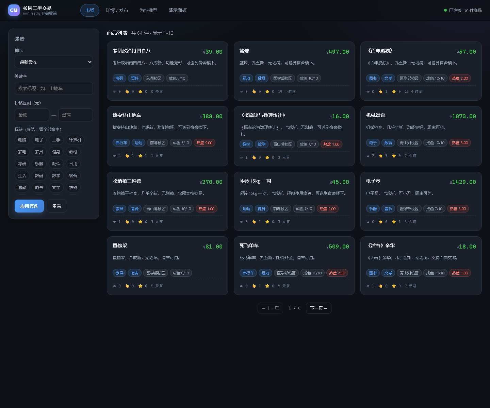
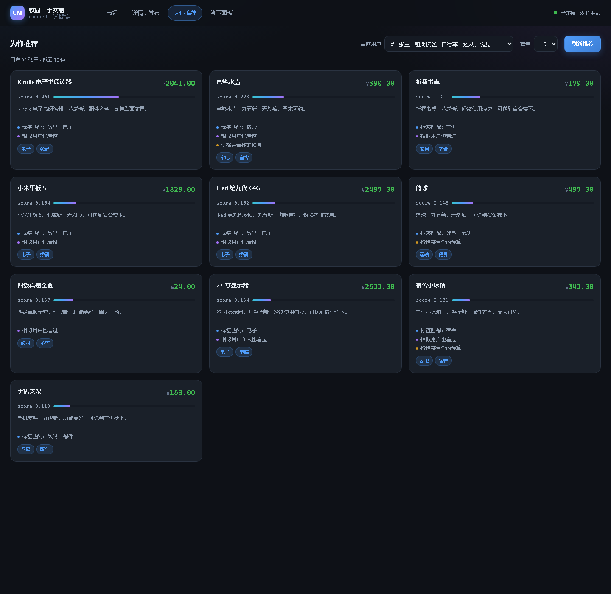
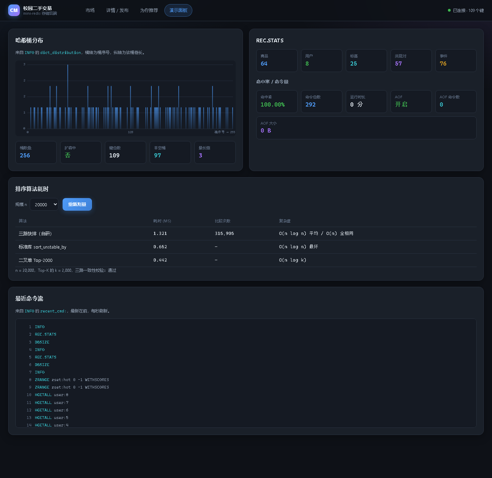

# campus-market · Rust mini-redis 驱动的校园二手交易推荐系统

> 课程实训项目 · 选题：**校园二手交易推荐（排序、哈希、简单推荐算法）**
> 大数据学院 · 25 本软件 X 班 · 2026–2027 学年第一学期

一个**从零手写**的 mini-redis（RESP 协议 + 自研哈希表 + 跳表 + AOF 持久化），在其上嵌入一个**可解释的混合推荐引擎**（三路快排 / 二叉堆 top-k / 倒排索引 / Jaccard / 共现矩阵协同过滤），再用 axum 暴露 REST 网关与原生前端。

**没有使用 `std::collections::HashMap` 作为核心存储**，也没有使用任何推荐算法库——哈希表、跳表、排序、索引、相似度、协同过滤全部手写。

---

## 目录

- [快速开始](#快速开始)
- [架构](#架构)
- [算法实现](#算法实现)
- [功能演示](#功能演示)
- [命令参考](#命令参考)
- [性能数据](#性能数据)
- [项目结构](#项目结构)
- [设计取舍](#设计取舍)
- [测试](#测试)

---

## 快速开始

### 环境要求

| 项 | 版本 |
|---|---|
| Rust | 1.85+（实测 1.99.1，edition 2024） |
| 平台 | Windows 10/11（MSVC 工具链）；Linux/macOS 亦可 |
| 浏览器 | Chrome / Edge（演示面板用 canvas） |

### 一键启动

```powershell
cd campus-market
.\scripts\start.ps1
```

脚本会：编译 → 启动 `mredis-server`（6380，导入 `data/seed.json`，开启 AOF）→ 启动 `mredis-web`（8080）→ 打开浏览器。

停止：

```powershell
.\scripts\stop.ps1
```

### 手动启动

```powershell
cargo build --release --workspace

# 终端 1：存储引擎（导入种子数据 + AOF）
.\target\release\mredis-server.exe --port 6380 --seed data\seed.json `
    --appendonly yes --appendfsync everysec --aof-path data\runtime\appendonly.aof

# 终端 2：Web 网关
.\target\release\mredis-web.exe --http-port 8080 --redis-addr 127.0.0.1:6380

# 终端 3：命令行客户端
.\target\release\mredis-cli.exe -p 6380
```

浏览器打开 <http://127.0.0.1:8080/>。

### 参数一览

`mredis-server`：

| 参数 | 默认 | 说明 |
|---|---|---|
| `--host <ip>` | `127.0.0.1` | 监听地址 |
| `--port <n>` | `6380` | 监听端口；`0` 由系统分配并打印真实端口 |
| `--appendonly <yes\|no>` | `yes` | 开启 AOF（`no` = 纯内存演示模式） |
| `--appendfsync <always\|everysec\|no>` | `everysec` | 刷盘策略；命令即时写穿到操作系统，这一档只决定 `fsync` 频率 |
| `--aof-path <path>` | `data/runtime/appendonly.aof` | AOF 文件；同目录会生成 `<aof>.ready` 初始化标记 |
| `--seed <path>` | — | **首次**初始化持久化存储时导入种子 JSON（之后不再导入） |
| `--flush-on-start` | off | 启动前清空键空间、AOF 文件与初始化标记 |
| `--verbose` | off | 打印每条命令 |

`mredis-web`：`--http-port`（默认 8080）、`--redis-addr`（默认 `127.0.0.1:6380`）。

---

## 架构

```
┌──────────────────────────────────────────────┐
│  Web UI（原生 HTML/CSS/JS，零第三方库）       │
│  市场 · 详情/发布 · 为你推荐 · 演示面板        │
└───────────────────┬──────────────────────────┘
                    │ HTTP + JSON（axum 0.8）
┌───────────────────▼──────────────────────────┐
│  mredis-web  REST 网关                        │
│  参数校验 / 键空间拼装 / INFO 解析 / bench     │
└───────────────────┬──────────────────────────┘
                    │ RESP2（自有协议栈）
┌───────────────────▼──────────────────────────┐
│  mredis-server（mini-redis）                  │
│  ┌─────────────────────────────────────────┐ │
│  │ 协议层  Decoder/Encoder（半帧续传状态机）│ │
│  ├─────────────────────────────────────────┤ │
│  │ 命令层  60+ 命令 · arity 校验 · MULTI/EXEC│ │
│  ├─────────────────────────────────────────┤ │
│  │ 存储层  自研 Dict（链地址+增量 rehash）  │ │
│  │         跳表 ZSet（span 实现 O(log n) 排名）│
│  │         String / Hash / List / Set      │ │
│  │         TTL（惰性 + 主动过期）           │ │
│  ├─────────────────────────────────────────┤ │
│  │ 持久层  AOF（追加写 + 三档 fsync + 重放）│ │
│  ├─────────────────────────────────────────┤ │
│  │ 领域层  REC.* 八个命令                   │ │
│  └────────────────┬────────────────────────┘ │
└───────────────────┼──────────────────────────┘
                    │ 内存调用
┌───────────────────▼──────────────────────────┐
│  campus-rec 推荐引擎                          │
│  三路快排 / 二叉堆 top-k / 倒排索引           │
│  Jaccard · 余弦 · 共现矩阵 · 混合打分          │
└──────────────────────────────────────────────┘
```

**为什么把推荐引擎放在服务端进程内？** 因为推荐需要**全量**的倒排索引与共现矩阵，逐次 RPC 拉取会产生 N+1 查询；放进进程内是 O(1) 内存访问。同时 `REC.*` 作为一等命令参与命令分发、AOF 与 `INFO` 统计，保持了「一切皆命令」的一致性。

### 持久化与启动流程

启动顺序是有讲究的，**顺序错了会丢数据或让已删除的数据复活**：

```
1. 若 --flush-on-start：清空键空间 + 删除 AOF 文件与 <aof>.ready 标记
2. 若 --appendonly：
     a. 读 AOF（末尾半帧截断容错）
     b. 首次初始化（AOF 为空，或缺少 <aof>.ready 标记）且给了 --seed
        → 导入种子，再把整个键空间写成全量快照，最后写 <aof>.ready 标记
     c. 已有持久化数据 → 跳过种子导入
3. 重放 AOF 全部命令
4. rebuild_rec_from_keyspace()            ← 由键空间重建推荐索引
```

四个设计要点：

- **种子只导入一次。** 首次初始化后，种子被写进 AOF 的全量快照，成为持久化数据的一部分；之后重启不再导入，所以**删除或修改种子商品不会在重启后复活**。`<aof>.ready` 是初始化完成的标记（sidecar 文件，不占键空间）；若崩溃在初始化中途，下次会重做一遍——快照对每个键先 `DEL`，天然幂等。
- **写穿 + 后台 fsync。** 每条写命令立即 `flush` 到操作系统页缓存（进程被强杀也不丢已确认的命令）；`appendfsync everysec` 只决定 `fsync` 频率，由后台线程每 200ms 检查一次。若命令还留在用户态 `BufWriter` 里、只靠每秒 fsync，空闲进程被强杀会丢掉整段数据。
- **`db.rec` 是键空间的派生视图。** 推荐引擎的商品/用户/事件/收藏四份数据全部能从 `product:<id>`、`user:<id>`、`user:<uid>:events`、`user:<uid>:favs` 还原，所以重启后直接整体重建，不依赖 AOF 里有没有 `REC.*` 命令。这也让 `BGREWRITEAOF` 之后依然能恢复推荐能力。
- **计数不翻倍。** 哈希里的 `views/clicks/favs` 是权威值（`REC.TRACK` 增量维护，不随 200 条流水截断），重建时先用清零计数构造 `Recommender`，再把权威计数 `upsert_product` 覆盖回去。

**优雅停机**：`SHUTDOWN [SAVE|NOSAVE]` 回复 `+OK` 后 fsync 并退出；`scripts/stop.ps1` 优先发 SHUTDOWN，失败才 `Kill()`。

---

## 算法实现

### 1. 哈希：自研 `Dict`（`crates/mredis-core/src/dict.rs`）

| 设计点 | 实现 |
|---|---|
| 冲突解决 | 链地址法（每桶 `Option<Box<Node>>` + `next` 链） |
| 哈希函数 | FNV-1a 64 位（乘法 + 异或，无随机种子，便于复现） |
| 扩容 | 负载因子 `used/buckets > 1.0` 触发，新容量 = ≥`2×used` 的 2 的幂 |
| 缩容 | 负载因子 < 0.1 且桶数 > 16 时收缩 |
| 渐进式 rehash | **双表结构**，每次操作顺带迁移 `rehash_step` 个桶，避免大表一次性 rehash 造成停顿 |
| 迭代 | `SCAN` 游标（rehash 期间按高位反向递增，保证不漏不重） |
| 可观测 | `bucket_distribution()` 输出每条链的长度，供演示面板画柱状图 |

**为什么渐进式 rehash？** 一次性 rehash 一个 10 万键的表需要重新计算 10 万次哈希并搬移节点，会造成几十毫秒的停顿。Redis 的做法是保留新旧两张表，每次增删查都顺带迁移一小批桶，把 O(n) 的停顿摊薄成 O(1) 的常数开销。

### 2. 跳表：`ZSet`（`crates/mredis-core/src/zset.rs`）

- 层高 1/4 概率递增，最多 32 层
- 每层节点记录 `span`（跨度），`ZRANK` 可在 **O(log n)** 内算出排名，而不是 O(n) 遍历
- 同分时按成员字典序排列，保证顺序确定

**为什么不用平衡树？** 跳表实现更简单、区间查询天然有序、并发版本（无锁跳表）更容易写。Redis 选跳表而非红黑树正是这个原因。

### 3. 排序（`crates/campus-rec/src/sort.rs`）

- **三路快排** `three_way_quick_sort`：median-of-3 选枢轴 + 三路划分（`<`、`=`、`>`）+ 小区间（≤16）插排 + 只对较小一侧递归
  - 三路划分在**大量重复键**下不退化为 O(n²)（校园市场里价格、成色重复极多）
- **二叉堆 top-k**：维护大小为 k 的最小堆，O(n log k)，取「前 10 个推荐」时比全排序快一个量级
- 三级 tie-break：主排序键 → `created_at` 降序 → `id` 升序（保证分页结果确定）

### 4. 倒排索引（`crates/campus-rec/src/index.rs`）

`HashMap<标签, Vec<商品 id>>`，posting list 保持升序；多标签查询用**双指针归并求交**，O(m+n)，不用 HashSet 去重（省掉哈希开销与内存分配）。

### 5. 相似度（`crates/campus-rec/src/similarity.rs`）

- **Jaccard**：`|A∩B| / |A∪B|`，两边都空时定义为 0
- **余弦**：稀疏向量点积 / 模长乘积，用于带权行为向量

### 6. 协同过滤（`crates/campus-rec/src/cf.rs`）

共现矩阵：5 分钟窗口内同一用户的两个行为视为一次共现，键用 `(min, max)` 对称存储，空间从 O(n²) 降到 O(实际共现对数)。

### 7. 混合推荐（`crates/campus-rec/src/recommender.rs`）

```
score = 0.45 × tag_sim        // 内容：兴趣标签 Jaccard
      + 0.25 × cf_sim         // 协同：共现相似用户
      + 0.10 × hot_norm       // 热度：重力衰减归一化
      + 0.05 × price_fit      // 价格契合度
      + 0.15 × campus_fit     // 同校区（≈ 可当面交易）
```

**召回与门槛**：候选来自「兴趣标签倒排命中 ∪ 相似用户交互过的商品」，但**必须命中至少一个兴趣标签**才会进入排序——纯协同过滤召回的商品若与画像毫无交集，会与页面展示的兴趣标签自相矛盾，因此直接丢弃。

**重排规则**（打分之后的业务约束）：

- 同一卖家最多出现 2 个商品（避免刷屏）
- 与已选商品标签 Jaccard > 0.8 的降权 ×0.6（避免重复推荐）
- 排除**已收藏**商品与显式 exclude 列表；浏览/点击过的商品仍可再推（目录只有 64 件，全排会很快无货可推）
- **冷启动**：用户无兴趣标签 → 回退热度榜，理由标记为「冷启动·热门推荐」；兴趣标签在库中无在售商品时同样回退

每条推荐都带**可解释理由**（`tag_match` / `similar_users` / `trending` / `price_fit` / `campus_match` / `cold_start`），这是本项目区别于黑盒推荐的核心设计。

> 完整的公式推导、伪代码、复杂度分析见 [`docs/ALGORITHMS.md`](docs/ALGORITHMS.md)。

---

## 功能演示

4 个视图（单页无刷新切换）：

| 视图 | 内容 |
|---|---|
| **市场** | 商品卡片网格；侧栏筛选：排序（价格↑↓ / 最新 / 热度 / 成色）、标签多选（AND）、价格区间、关键字；分页 |
| **详情/发布** | 商品详情 + 「浏览 / 想要 / 收藏」按钮（写回 `REC.TRACK`）+ 发布表单；**商品管理**：编辑信息、标记已售出/恢复在售、删除（PATCH/DELETE 立即写 AOF，重启后依然生效） |
| **为你推荐** | 选用户 → 推荐卡片，**每条展示 score 与中文理由** |
| **演示面板** | canvas 手绘哈希桶分布柱状图、最近 50 条命令流、排序算法耗时表、`REC.STATS` 数字卡片 |

每个视图都有深链接，刷新和浏览器前进/后退都能回到同一处：`#market`、`#detail/<id>`、`#recommend`、`#demo`。
演示时可以提前把 `http://127.0.0.1:8080/#detail/1` 存成书签，直接跳到某个商品。

### REST 接口

| 方法 | 路径 | 说明 |
|---|---|---|
| GET | `/api/health` | 健康检查（含 `dbsize`） |
| GET | `/api/products?sort=&tags=&min=&max=&q=&limit=&offset=` | 商品列表 / 筛选 / 排序 |
| GET | `/api/products/{id}` | 商品详情 |
| POST | `/api/products` | 发布商品（201） |
| PATCH | `/api/products/{id}` | 编辑商品（部分字段，校验后写回） |
| DELETE | `/api/products/{id}` | 删除商品（同时清标签索引与热度榜） |
| POST | `/api/products/{id}/event` | 记录浏览/想要/收藏 |
| GET | `/api/recommend?user_id=&limit=` | 个性化推荐 |
| GET | `/api/similar/{id}?limit=` | 相似商品 |
| GET | `/api/hot?limit=` | 热度榜 |
| GET | `/api/users` | 用户列表 |
| GET | `/api/stats` | 运行统计（哈希桶分布、命中率、命令流、AOF、推荐索引规模） |
| GET | `/api/bench/sort?n=` | 现场跑三种排序算法并返回耗时 |

**截图**（`docs/screenshots/`）：

| 市场（筛选 + 排序 + 分页） | 为你推荐（带 score 与中文理由） |
|---|---|
|  |  |

| 详情 / 发布 | 演示面板（哈希桶分布 + 命令流 + 排序耗时） |
|---|---|
|  |  |

5 分钟现场演示脚本见 [`docs/DEMO.md`](docs/DEMO.md)（含老师提问预案）。

---

## 命令参考

实现了 76 条命令：68 条 Redis 兼容命令（含 `SHUTDOWN`）+ 8 条领域命令（`REC.*`）。

**连接/服务**：`PING` `ECHO` `SELECT` `INFO` `DBSIZE` `FLUSHDB` `COMMAND` `BGREWRITEAOF` `SHUTDOWN` `MULTI` `EXEC` `DISCARD`

**字符串/键**：`SET` `GET` `SETNX` `MSET` `MGET` `INCR` `DECR` `INCRBY` `DECRBY` `APPEND` `STRLEN` `DEL` `EXISTS` `TYPE` `EXPIRE` `PEXPIRE` `PEXPIREAT` `TTL` `PTTL` `PERSIST` `KEYS` `SCAN`

**哈希**：`HSET` `HGET` `HMSET` `HMGET` `HGETALL` `HDEL` `HEXISTS` `HINCRBY` `HKEYS` `HVALS` `HLEN`

**列表**：`LPUSH` `RPUSH` `LPOP` `RPOP` `LRANGE` `LLEN` `LTRIM`

**集合**：`SADD` `SREM` `SMEMBERS` `SISMEMBER` `SCARD` `SINTER` `SUNION` `SDIFF`

**有序集合**：`ZADD` `ZRANGE` `ZREVRANGE` `ZSCORE` `ZRANK` `ZREM` `ZCARD` `ZINCRBY`

**领域命令**：

```
REC.TRACK <user_id> <product_id> <view|click|fav>   → 1
REC.UPSERT <product_id>                              → 1（把商品哈希灌进推荐索引）
REC.REBUILD                                          → OK（从键空间整体重建推荐索引）
REC.FOR_YOU <user_id> [limit]                        → JSON 数组
REC.SIMILAR <product_id> [limit]                     → JSON 数组
REC.HOT [limit]                                      → JSON 数组
REC.EXPLAIN <product_id> <user_id>                   → JSON 对象（分数拆解）
REC.STATS                                            → JSON 对象
```

**停机**：`SHUTDOWN [SAVE|NOSAVE]` → `+OK`，服务端 fsync 后退出（`SAVE` 是默认值）。

示例（真实输出，`REC.EXPLAIN 2 1` 表示「给用户 1 推荐商品 2 的分数是怎么算出来的」）：

```
127.0.0.1:6380> REC.EXPLAIN 2 1
{"product_id":2,"score":0.6001,
 "parts":{"tag_sim":0.6667,"cf_sim":1.0,"hot_norm":0.1127,
          "price_fit":0.7759,"campus_fit":0.0},
 "weights":{"tag":0.45,"cf":0.25,"hot":0.1,"price":0.05,"campus":0.15},
 "matched_tags":["自行车","运动"],"similar_users":[7,2,4]}
```

五个 `parts` 分别是兴趣标签 Jaccard、协同过滤相似度、归一化热度、价格贴合度、同校区贴合度；
`0.45×0.6667 + 0.25×1.0 + 0.10×0.1127 + 0.05×0.7759 + 0.15×0.0 ≈ 0.6001`，可以当场手算验证。

---

## 性能数据

测试环境：Windows 11 / `cargo 1.99.1` / `--release`（`opt-level=3`、`lto="thin"`、`codegen-units=1`），每个测量点跑 7 次取中位数。

### 排序：三路快排 vs 标准库 vs 二叉堆 top-k

算法库内测，不含网络与序列化。复现：`cargo run -p campus-rec --release --example bench_sort`。
比较器用 `SortKey::Hot`（含 `powf` 热度计算，最贴近真实调用），`top_k` 取 `k=10`（即「推荐前 10 条」的真实场景）：

| n | three_way_quick | std `sort_unstable_by` | top_k（堆，k=10） | 快排/标准库 | top_k/全排序 |
|---|---|---|---|---|---|
| 1,000 | 0.653 ms | 0.543 ms | 0.035 ms | 0.83× | **15.4×** |
| 10,000 | 9.593 ms | 8.185 ms | 0.292 ms | 0.85× | **28.0×** |
| 100,000 | 126.038 ms | 109.913 ms | 2.753 ms | 0.87× | **39.9×** |

**诚实结论**：自研三路快排比 Rust 标准库的 pdqsort **慢 13%~17%**——pdqsort 是工业级实现，带「已有序检测」「划分不平衡时切 heapsort」等启发式，我们不自欺地宣称超越它。**真正的性能亮点是 top-k**：用大小为 k 的最小堆做到 O(n log k)，n=100k 时比全排序快 **40 倍**，且 n 越大优势越大——这才是生产环境取「前 10 条推荐」的正确做法。

### 倒排索引 vs 线性扫描

单标签查询（命中约 5% 商品）：

| n | 倒排索引 | 线性扫描 | 加速比 |
|---|---|---|---|
| 1,000 | 0.0002 ms | 0.0050 ms | ~1.5 个数量级 |
| 10,000 | 0.0002 ms | 0.1207 ms | ~2.5 个数量级 |
| 100,000 | 0.0013 ms | 1.4802 ms | **~3 个数量级** |

> 绝对耗时已接近计时器分辨率，倍数抖动较大（重复跑出现 25×~1350× 的区间），因此只给量级结论。

### 推荐计算（算法库内测）

`recommend_for_user(limit=10)` 单次耗时 **39~44 µs**（约 24,000 QPS 单线程）。优化过程见 `docs/ALGORITHMS.md` §7.5：把重排内循环的约 5000 次小集合 `jaccard` 改成零分配的 `jaccard_no_alloc`，耗时降低 73%。

### 端到端基准（`mredis-bench`）

上面两张表是**算法库内测**（`cargo run -p campus-rec --release --example bench_sort`，`k=10`）。
`mredis-bench` 是**走完整链路**的另一套测量：浏览器 → axum HTTP → RESP → mredis-core → campus-rec。
两套数字不可直接比较——`mredis-bench` 的 `k = n/10`（取前 10%），且含 HTTP 序列化/反序列化与网络往返。

```bash
# 需要 mredis-server + mredis-web 已启动
cargo run -p mredis-web --release --bin mredis-bench -- --rounds 300
```

| n | three_way_quick | std `sort_unstable_by` | heap_top_k | 快排比标准库慢 | top_k/全排序 |
|---|---|---|---|---|---|
| 1,000（k=100） | 0.038 ms | 0.017 ms | 0.011 ms | 2.24× | **3.45×** |
| 10,000（k=1,000） | 0.517 ms | 0.191 ms | 0.145 ms | 2.71× | **3.57×** |
| 100,000（k=10,000） | 6.80 ms | 2.51 ms | 1.91 ms | 2.71× | **3.56×** |

推荐接口 `GET /api/recommend?user_id=1&limit=10` 共 300 次：

| 指标 | 耗时 |
|---|---|
| 平均 | 1.008 ms |
| P50 | 0.974 ms |
| P90 | 1.229 ms |
| P99 | 1.468 ms |
| 最快 / 最慢 | 0.733 ms / 1.697 ms |

> **两套数字为什么差这么多？** 上面这张表的比较器只比 `(price_cents, created_at, id)` 三个整数，
> 单次比较极便宜，算法本身的常数因子就占主导 —— 自研快排比 pdqsort 慢 **2.2~2.7 倍**。
> 而算法库内测那张表的比较器带 `powf` 热度计算，比较成本远大于排序逻辑本身，
> 差距被摊薄到 **10~13%**。这说明「自研排序比标准库慢多少」这个问题**没有唯一答案**，
> 取决于比较函数有多贵 —— 我们在 `docs/ALGORITHMS.md` §8.3 里把这个 trade-off 写清楚了。

> 为什么 `mredis-bench` 里 top-k 的领先幅度（3.4~3.6×）远小于内测的 15~40×？
> 因为这里 `k = n/10` 很大，堆的 `log k` 优势被摊薄；`k` 越小优势越明显（内测取 `k=10`）。
> 这恰好说明 top-k 的收益取决于**要取多少条**，而不是无条件的。
> 端到端 P99 也只有 1.5 ms，说明 HTTP + RESP 两跳的开销远小于推荐计算本身。

> 完整的公式推导、伪代码、复杂度分析与全部实测表格见 [`docs/ALGORITHMS.md`](docs/ALGORITHMS.md)。

---

## 项目结构

```
campus-market/
├── Cargo.toml                    # workspace（6 个 crate）
├── crates/
│   ├── mredis-proto/             # RESP2 编解码（零依赖，半帧续传状态机）
│   ├── mredis-client/            # RESP 客户端（CLI/Web/测试复用）
│   ├── mredis-core/              # 存储引擎 + 命令层 + AOF + 服务端
│   │   ├── dict.rs               #   ← 自研哈希表
│   │   ├── zset.rs               #   ← 跳表
│   │   ├── db.rs / obj.rs        #   ← 键空间 + 五种类型 + TTL
│   │   ├── cmd_*.rs              #   ← 各类型命令
│   │   ├── command.rs            #   ← 命令表 + 分发 + MULTI
│   │   ├── aof.rs                #   ← 持久化
│   │   ├── info.rs               #   ← INFO 输出
│   │   └── server.rs             #   ← TCP 监听
│   ├── campus-rec/               # 推荐引擎
│   │   ├── sort.rs               #   ← 三路快排 + 二叉堆 top-k
│   │   ├── index.rs              #   ← 倒排索引
│   │   ├── similarity.rs         #   ← Jaccard / 余弦
│   │   ├── cf.rs                 #   ← 共现矩阵
│   │   ├── hot.rs                #   ← 热度衰减
│   │   └── recommender.rs        #   ← 混合推荐 + 重排 + 冷启动
│   ├── mredis-cli/               # mredis-cli + mredis-seed
│   └── mredis-web/               # axum 网关 + mredis-bench
├── web/                          # 原生前端（index.html / app.js / style.css）
├── data/seed.json                # 种子数据（64 商品 / 8 用户 / 76 行为）
├── docs/
│   ├── SPEC.md                   # 接口契约
│   ├── ALGORITHMS.md             # 算法设计文档
│   └── DEMO.md                   # 演示脚本
└── scripts/
    ├── start.ps1 / stop.ps1      # 一键启停
    ├── check.ps1                 # fmt + clippy + test + build
    └── gen_seed.py               # 种子数据生成（确定性随机）
```

---

## 设计取舍

| 决策 | 选择 | 理由 |
|---|---|---|
| 协议 | 自实现 RESP2 | 课程要求「结合算法思想」；用现成库看不到协议解析、半帧续传这些细节 |
| 并发模型 | 每连接一线程 + `Arc<Mutex<Database>>` | 单机课程项目够用、代码可读；文档记录了演进方向（tokio 单线程 + 分片锁） |
| 哈希表 | 自研链地址 + 渐进 rehash | 这是选题「哈希」的核心；`std::HashMap` 看不到扩容与 rehash |
| 推荐位置 | 进程内，`REC.*` 命令 | 避免 N+1 RPC；参与 AOF 与 INFO 统计，保持「一切皆命令」 |
| 前端 | 原生 JS，零依赖 | 无构建步骤，直接 `include_str!` 内嵌进二进制，单文件可执行 |
| 价格单位 | 整数「分」 | 避免浮点误差（`f64` 表示 45.00 会有精度问题） |
| 种子数据 | 确定性随机（固定 seed） | 演示与测试可复现 |

---

## 测试

```powershell
.\scripts\check.ps1          # fmt + clippy + test + release build
.\scripts\check.ps1 -Fix     # 先 cargo fmt 再检查
```

覆盖情况：**426 个测试全绿，0 失败**。

| crate | 数量 | 测试重点 |
|---|---|---|
| `mredis-proto` | 17 | 编解码往返、分片输入（半帧续传）、非法帧、超大 bulk |
| `mredis-client` | 5 | 连接、命令往返、错误帧、超时 |
| `campus-rec` | 128 | 排序与 `slice::sort_by` 随机 1000 组逐元素比对；top-k 与全排序前 k 比对；空集/单元素/全相同/逆序边界；倒排索引与 `HashSet` 结果比对；Jaccard 边界；共现对称性；推荐冷启动、兴趣标签硬门槛、同校区加分、排除已收藏与重排规则 |
| `mredis-core` | 159 | 哈希表增删改查 / 扩容后可达性 / rehash 中途读写 / SCAN 不漏不重 / 与 `std::HashMap` 10 万随机键比对；跳表与 `BTreeMap` 1000 次随机操作比对；各类型命令；TTL 过期；AOF 重放、截断容错、写穿与后台 fsync；**15 个端到端真进程用例**（含 AOF 重启、BGREWRITEAOF 后重启、种子只导入一次、硬杀后写命令存活、`SHUTDOWN`） |
| `mredis-cli` | 17 | 参数解析、一次性模式、REPL 命令分发 |
| `mredis-web` | 100 | `tower::ServiceExt::oneshot` 直打 router 验证 200/400/404 与 JSON 契约（53 个 HTTP 集成，含 PATCH/DELETE）+ 假后端单测 + 基准二进制 |

除单元测试外，仓库里还有四个**独立于 Rust 测试框架**的验收脚本（Python 手写 RESP/HTTP，用来抓「假后端比真后端宽容」这类跨层缺陷）：

| 脚本 | 作用 |
|---|---|
| `scripts/verify_persistence.py` | 四轮持久化验收：首启 → AOF 重启 → BGREWRITEAOF → 重写后重启，逐轮比对 DBSIZE / REC.STATS / `hot_norm` / `REC.FOR_YOU` |
| `scripts/restart_e2e.py` | 真实可用性验收：Web 发布 → **强杀进程** → 重启，商品仍在；PATCH 修改与 DELETE 删除同样跨硬杀存活 |
| `scripts/web_e2e.py` | Web 端到端 8 组 53 项断言：五种排序单调性、四类 400 校验、发布→可搜、编辑/删除（真实 CRUD）、推荐标签硬门槛、收藏后排除、limit 边界 |
| `scripts/web_e2e_runner.py` | 在全新存储上自动起停一套服务再跑 `web_e2e.py`，无需手工 `start.ps1` |

```bash
python scripts/verify_persistence.py   # 自带启停，用 7801 端口，不干扰主服务
python scripts/restart_e2e.py          # 自带启停，用 16391/18091 端口，硬杀重启验证
python scripts/web_e2e_runner.py       # 自带启停，用 6380/8080，跑完自动 SHUTDOWN
```

---

## 许可

课程作业，仅供学习参考。
